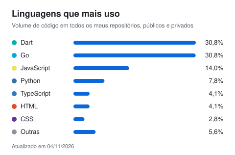

# Olá, eu sou o Lucas Nascimento

**Desenvolvedor com IA · Back-end e Machine Learning · Rio de Janeiro**

Sou estagiário de IA na MJV Technology & Innovation, onde construo agentes de IA com AWS Bedrock. Termino Ciência da Computação na FMU em dezembro de 2026 e fiquei entre os 10% melhores alunos da turma em 2023 e 2024.

Trabalho principalmente com Python e TypeScript: APIs assíncronas, pipelines RAG, agentes com LLMs e aplicações com testes automatizados.

## O que faço hoje

**Estagiário de IA na MJV** (desde jul/2026)
- Agentes de IA para automação de operações internas e de fluxos voltados ao cliente, integrados a microsserviços na AWS e a foundation models via AWS Bedrock.
- Camada de orquestração em TypeScript sobre Bun, painel de operação em React 19, dados no AWS RDS e deploy pelo AWS CodePipeline.
- Migração de um sistema interno de um protótipo no-code para React, Express/TypeScript e MySQL.
- Agent Skills reutilizáveis para padronizar como os estagiários desenvolvem com Claude Code, Codex e OpenCode.

## Projetos

### [Scriptura AI](https://github.com/DevLucas05/scriptura-ai-public)
Micro-SaaS que gera estudos bíblicos personalizados com LLMs. Usa RAG sobre a Bíblia NVI (ChromaDB e Sentence-Transformers), adapta a linguagem do texto à faixa etária do público e alterna entre Ollama (local) e Groq (nuvem) sem mudar código.
`Python` `FastAPI` `ChromaDB` `Ollama` `Groq` `React 19` `Tailwind CSS 4`

### Foco *(repositório privado)*
App Android de produtividade para pessoas com TDAH, offline-first e em português. Tem tarefas em lista e Kanban, Pomodoro, plano diário e widgets na tela inicial. O SQLite do aparelho é a fonte da verdade e a sincronização não trava a interface. O backend tem autenticação JWT com rotação de refresh token, integração com Google Agenda e funções de exportação e exclusão de dados (LGPD). O CI no GitHub Actions roda mais de 500 testes automatizados.
`Flutter` `Dart` `Riverpod` `Kotlin` `FastAPI` `PostgreSQL` `Alembic`

### Farol *(repositório privado)*
Plataforma de qualidade e segurança de código num único executável em Go. Faz análise estática em várias linguagens, detecção de segredos, análise de dependências e quality gates. Tem servidor com interface web embutida e integra com editores (LSP) e com agentes de IA (MCP). Também inclui um módulo de varredura de vulnerabilidades de rede com plugins assinados.
`Go` `SQLite` `LSP` `MCP`

### chat-rt *(repositório privado)*
Comunidade com chat em tempo real, voz, câmera e transmissão de tela.
`TypeScript` `React` `Fastify` `LiveKit` `PostgreSQL`

## Tecnologias

- **Linguagens:** Python, TypeScript, JavaScript, Dart, Kotlin, Go
- **Back-end:** FastAPI, Express, Bun, Node.js, Pydantic
- **Front-end e mobile:** React, Flutter, Tailwind CSS
- **IA e ML:** agentes de IA, RAG, AWS Bedrock, ChromaDB, Sentence-Transformers, Ollama, Groq, Scikit-Learn, PyTorch, Pandas
- **Dados:** PostgreSQL, MySQL, SQLite, AWS RDS
- **Infraestrutura:** AWS, Docker, GitHub Actions, Linux, Git

  

## Contato

- E-mail: lucasnascimento05.dev@gmail.com
- LinkedIn: [linkedin.com/in/lucas-nascimento-dev](https://linkedin.com/in/lucas-nascimento-dev)
- Portfólio: [devlucas05.github.io/Curriculo](https://devlucas05.github.io/Curriculo)

  
  
  
  
  
  

